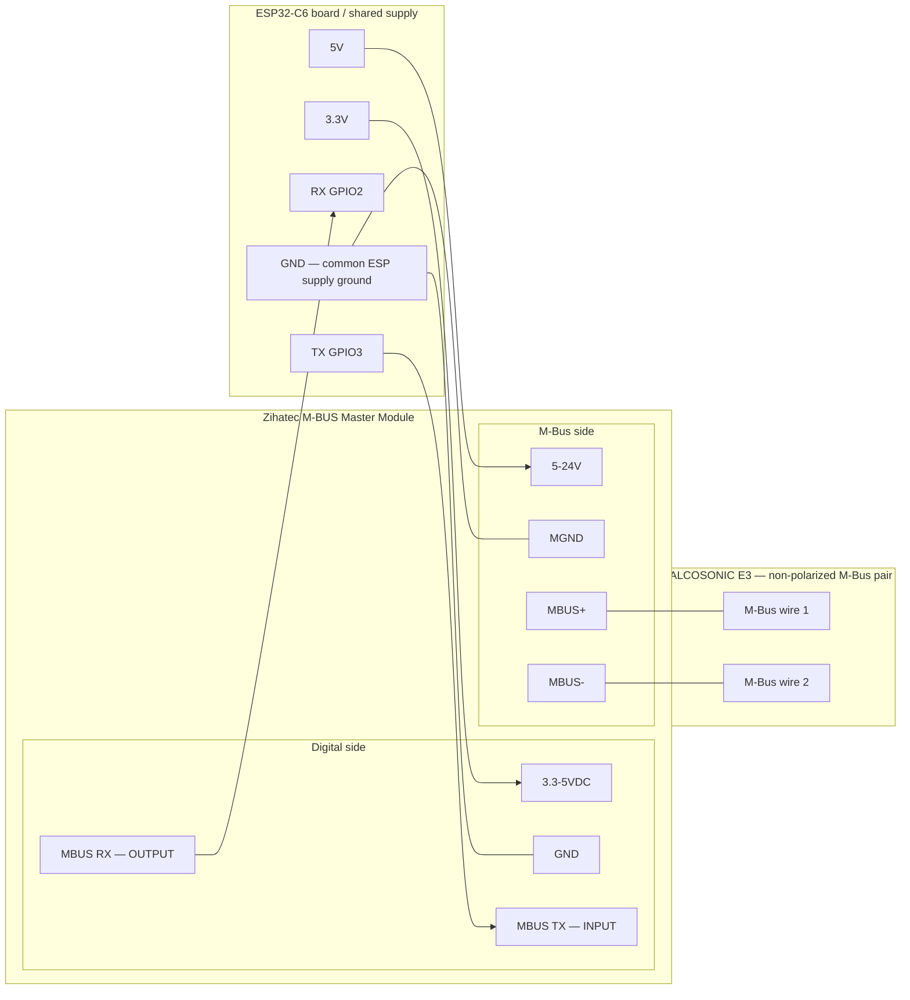
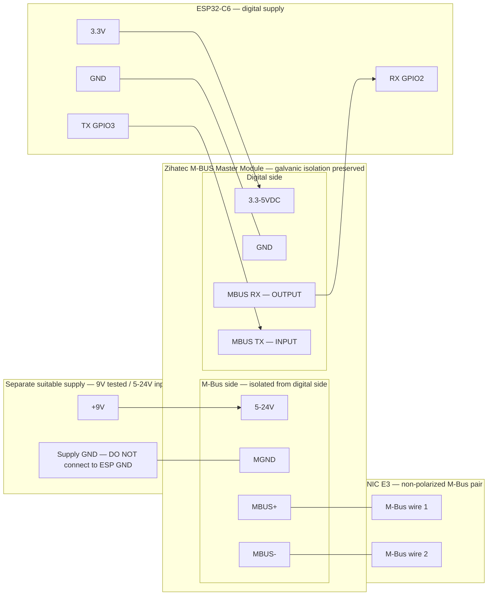

# ESPHome QALCOSONIC E3

ESPHome external component for reading Axioma QALCOSONIC E3 heat meters via M-Bus over UART.

Read energy, volume, power, flow, and temperatures directly into Home Assistant,
with meter diagnostics and a manual read button. The component supports optical
M-Bus through a TTL optical read/write head and wired M-Bus through a proper
M-Bus master/transceiver. Both use the same protocol and parser.

**Wired M-Bus is recommended when you have access to the wired M-Bus connection.**
It avoids optical alignment/head-placement problems and the optical inactivity
timeout, making it better suited to permanent unattended installations.

## Hardware

The tested setup uses an **Axioma QALCOSONIC E3**, a **Waveshare ESP32-C6-Zero**
with 8 MB flash, and a **TTL optical read/write head** powered from 3.3 V.

- [TTL IR read/write head](https://www.ebay.de/itm/356650595031)
- [Waveshare ESP32-C6-Zero](https://www.amazon.de/dp/B0F12PRH9G)

Other ESPHome-supported boards and compatible TTL heads should work with the
appropriate board configuration and wiring. The head must support both sending
and receiving, with logic levels compatible with the board. Communication uses
**2400 baud, 8E1**. The decoded data is specific to the QALCOSONIC E3.

## Installation and configuration

The following configuration enables the main measurements, readout
status, and manual read button:

```yaml
esphome:
  name: heat-meter

esp32:
  variant: esp32c6
  flash_size: 8MB
  framework:
    type: esp-idf

logger:

api:
  encryption:
    key: !secret heat_meter__encryption_key

ota:
  - platform: esphome
    encryption:

wifi:
  ssid: !secret wifi_ssid
  password: !secret wifi_password

external_components:
  - source:
      type: git
      url: https://github.com/hpuac/esphome-qalcosonic-e3.git
    components: [qalcosonic_e3]

uart:
  id: mbus_uart
  rx_pin: GPIO2
  tx_pin: GPIO3
  baud_rate: 2400
  data_bits: 8
  parity: EVEN
  stop_bits: 1
  rx_buffer_size: 512

qalcosonic_e3:
  uart_id: mbus_uart
  address: 0x01
  update_interval: 2min
  energy:
    name: "Energy"
  volume:
    name: "Volume"
  power:
    name: "Power"
  flow:
    name: "Flow"
  flow_temperature:
    name: "Flow Temperature"
  return_temperature:
    name: "Return Temperature"
  temperature_difference:
    name: "Temperature Difference"
  readout_successful:
    name: "Readout Successful"
  automatic_readout:
    name: "Automatic Readout"
  read_now:
    name: "Read Now"
```

Add your Wi-Fi credentials and API encryption key to `secrets.yaml`, and adjust
the board and GPIO pins for your hardware.

[The full example](examples/esp32-c6.yaml) includes every optional entity.
Each nested entity can be omitted, renamed, or configured with normal ESPHome
entity options (including `id`, filters for numeric sensors, and
`disabled_by_default: false`). Omitted entities are not created; the defaults
below apply when an entity is configured. Diagnostic entities are disabled in Home Assistant by default, except for
`readout_successful`. Enable them in Home Assistant or override the default:

```yaml
qalcosonic_e3:
  uart_id: mbus_uart
  address: 0x01
  error_code:
    name: "Error Code"
    disabled_by_default: false
```

The component requires both UART pins and validates 2400 baud, 8 data bits,
even parity, and 1 stop bit. Use a dedicated UART with a 512-byte RX buffer.

## M-Bus primary address

`address` is **required**, with no default. Configure the primary address for
the interface you use: optical and wired interfaces may have different primary
addresses even on the same physical meter. On the tested meter, optical used
`0x01` and wired M-Bus used `0x2C` (decimal 44).

Supported normal primary addresses are `0x00`–`0xFA`; `0xFE` is also supported as
a **test/point-to-point address**. Hexadecimal notation is supported.
`0xFB`, `0xFC`, `0xFD`, and `0xFF` are not supported. Secondary addressing/selection
with `0xFD` is not implemented. Broadcast address `0xFF` expects no response and
is incompatible with this component's request/response behavior.

Optical example (`0x01` was the tested meter's optical address):

```yaml
qalcosonic_e3:
  uart_id: mbus_uart
  address: 0x01
  update_interval: 2min
```

Wired example (`0x2C`, decimal 44, was the same meter's wired address):

```yaml
qalcosonic_e3:
  uart_id: mbus_uart
  address: 0x2C
  update_interval: 2min
```

Discovery/testing with **exactly one connected M-Bus slave**:

```yaml
qalcosonic_e3:
  uart_id: mbus_uart
  address: 0xFE
```

Every connected slave recognizes the test/point-to-point address `0xFE`, so use
it only with **exactly one slave connected**. Slaves respond using their real
primary address, which is logged for discovery. It is not appropriate for normal
multi-slave bus operation; this component does not implement a bus scanner.
For normal configured addresses, responses from other addresses are ignored;
the component keeps waiting for a matching response until timeout.
On the tested wired interface, `10 40 FE 3E 16` (SND_NKE) received `E5`, and
`10 5B FE 59 16` (REQ_UD2) received a valid frame with response address `0x2C`.
Requests are generated from the configured address, with checksum
`(control + address) & 0xFF`. REQ_UD2 retains the existing alternating frame count
bit (`0x7B` / `0x5B`) and retry behavior.

## Optical wiring

| ESP32      | TTL optical head |
| ---------- | ---------------- |
| 3.3 V      | VCC              |
| GND        | GND              |
| GPIO2 (RX) | TX → ESP RX      |
| GPIO3 (TX) | RX ← ESP TX      |

Pins are configurable. This is M-Bus, **not SML**. The component reads optical M-Bus through a
TTL head. The wired M-Bus interface uses the same high-level
telegram format but needs a proper M-Bus master/transceiver; never connect the
meter's M-Bus wires directly to ESP GPIO.

## Wired M-Bus hardware

The tested **Zihatec M-BUS Master Module** worked with an ESP32-C6 and a single
QALCOSONIC E3. See the [product/project page](https://www.hwhardsoft.de/2024/10/08/m-bus-master-breakout/).
The exact small module tested has three connector groups:

| Group                     | Connector labels                        |
| ------------------------- | --------------------------------------- |
| Power / M-Bus-side supply | `MGND`, `5-24V`                         |
| M-Bus                     | `MBUS+`, `MBUS-`                        |
| Digital side              | `3.3-5VDC`, `MBUS RX`, `MBUS TX`, `GND` |

Tested digital wiring:

| ESP32        | Zihatec module |
| ------------ | -------------- |
| 3.3 V        | `3.3-5VDC`     |
| GND          | Digital `GND`  |
| RX (GPIO2) ← | `MBUS RX`      |
| TX (GPIO3) → | `MBUS TX`      |

**For this module, RX connects to RX and TX connects to TX.**
`ESP RX GPIO2 ← Zihatec MBUS RX`; `ESP TX GPIO3 → Zihatec MBUS TX`.
`MBUS RX` is the isolated data **output** from the module toward the controller;
`MBUS TX` is the isolated data **input** from the controller.
Do not cross these signals as you might with conventional UART labels.

Connect the meter's M-Bus pair to `MBUS+` / `MBUS-`. The tested meter's M-Bus
connection is non-polarized, so either meter M-Bus wire can go to either terminal.
**Do not connect the meter's M-Bus wires directly to ESP GPIO pins.** A proper
M-Bus master/transceiver is required.

### M-Bus power supply and isolation

The module has a separate M-Bus-side supply input, `5-24V` and `MGND`.
A separate suitable 9 V supply was tested successfully; with no bus fault,
approximately 36 V was measured across `MBUS+` / `MBUS-`.

#### Variant A: Shared ESP supply, no galvanic isolation

The final tested setup worked from the development ESP32-C6 board's nominal 5 V rail:

| ESP board | Module             |
| --------- | ------------------ |
| 3.3 V     | Digital `3.3-5VDC` |
| GND       | Digital `GND`      |
| 5 V       | M-Bus-side `5-24V` |
| GND       | M-Bus-side `MGND`  |



**Galvanic isolation is lost because digital GND and MGND are connected through the ESP supply.**
Operation from the 5 V rail is an observation on the tested hardware, not a
guarantee that every ESP board's 5 V rail will work or provide enough current.

#### Variant B: Separate M-Bus-side supply, galvanic isolation preserved

To preserve galvanic isolation, use a separate suitable 5–24 V supply for the
M-Bus side. **Do not connect `MGND` to the ESP digital GND.** A separate 9 V
supply was successfully tested. A 9–12 V external
supply is a reasonable choice. Follow the module's specified input voltage and
current requirements and use a suitably rated, current-limited supply for the
connected bus load.



Both diagrams show RX connected to RX and TX connected to TX with arrows in the
data direction. Either meter wire may connect to `MBUS+` or `MBUS-` on the tested
non-polarized connection. The module's physical connector positions may differ
from the diagram; follow the printed labels.

## Optical interface and polling

On the tested QALCOSONIC E3, the optical interface became inactive after approximately **5 minutes without
communication**. After it sleeps, it requires local activation at the meter before communication resumes.
The default **2-minute** polling interval was used successfully for a long period and intentionally keeps it awake. Use an
interval below the inactivity timeout for continuous availability. Battery-current
consumption has not been measured, so no battery-life impact is quantified.
The optical interface is normally allowed to deactivate after inactivity;
continuous polling below that timeout keeps it active.

The optical interface was used successfully during development, but on the
tested installation it later became unreliable despite previously working.
No root cause was established, and this does not imply that all QALCOSONIC E3
optical interfaces will fail. For permanent installations, wired M-Bus is
therefore recommended when accessible.

Wired installations do not have the observed optical five-minute timeout and
can choose a longer `update_interval`. The global default remains two minutes
for backwards compatibility. After five minutes of link inactivity the component
resynchronizes with SND_NKE on either interface before requesting data.

With automatic readout enabled, the first reading starts about 10 seconds after
startup. Use `update_interval` to change the polling interval. Configure
`automatic_readout` to expose a switch that pauses scheduled reads when off.
The switch starts on after a reboot by default. Turning it back on restarts
the polling interval. `read_now` still requests a reading while automatic
readout is off. A read already in progress finishes when the switch is turned off.
The component only reads meter data; it does not change meter settings.

## Entities

| Entity key                     | Type          | Unit | Default  | Category   |
| ------------------------------ | ------------- | ---- | -------- | ---------- |
| `energy`                       | Sensor        | MWh  | Enabled  | Normal     |
| `volume`                       | Sensor        | m³   | Enabled  | Normal     |
| `power`                        | Sensor        | kW   | Enabled  | Normal     |
| `flow`                         | Sensor        | m³/h | Enabled  | Normal     |
| `flow_temperature`             | Sensor        | °C   | Enabled  | Normal     |
| `return_temperature`           | Sensor        | °C   | Enabled  | Normal     |
| `temperature_difference`       | Sensor        | K    | Enabled  | Normal     |
| `error_code`                   | Sensor        | —    | Disabled | Diagnostic |
| `battery_operating_duration`   | Sensor        | d    | Disabled | Diagnostic |
| `operating_time_without_error` | Sensor        | d    | Disabled | Diagnostic |
| `protocol_version`             | Sensor        | —    | Disabled | Diagnostic |
| `meter_datetime`               | Text sensor   | —    | Disabled | Diagnostic |
| `error_start`                  | Text sensor   | —    | Disabled | Diagnostic |
| `serial_number`                | Text sensor   | —    | Disabled | Diagnostic |
| `manufacturer`                 | Text sensor   | —    | Disabled | Diagnostic |
| `readout_successful`           | Binary sensor | —    | Enabled  | Diagnostic |
| `readout_failures`             | Sensor        | —    | Disabled | Diagnostic |
| `automatic_readout`            | Switch        | —    | Enabled  | Config     |
| `read_now`                     | Button        | —    | Enabled  | Config     |

Battery operating duration is **elapsed operating time**, not percentage or
remaining battery life.

Meter error code and error start describe the meter itself. Error start is
`No error` when the error code is zero; otherwise dates use `YYYY-MM-DD HH:MM`,
without timezone conversion. Missing records leave existing states unchanged.

`readout_successful` reports whether the last read succeeded and stays unknown
until the first result. A read times out after 2 seconds. `readout_failures`
counts consecutive failed reads since the last successful read and resets to
zero after a successful read or when the ESP restarts.

`unavailable_after_failures` sets the number of consecutive failed reads before
numeric meter sensors publish `NaN` (shown as **unknown** in Home Assistant).
They publish `NaN` once per failure streak, when the threshold is reached.
The default `0` keeps the last measurements.

```yaml
qalcosonic_e3:
  uart_id: mbus_uart
  address: 0x01
  update_interval: 2min
  unavailable_after_failures: 5
```

A successful read resets the failure streak and updates received values.
Text sensors retain their values; sensor filters can suppress or replace `NaN`.

## Contributing

See [CONTRIBUTING.md](CONTRIBUTING.md) for local development, tests, and formatting.

## License

[MIT](LICENSE).
